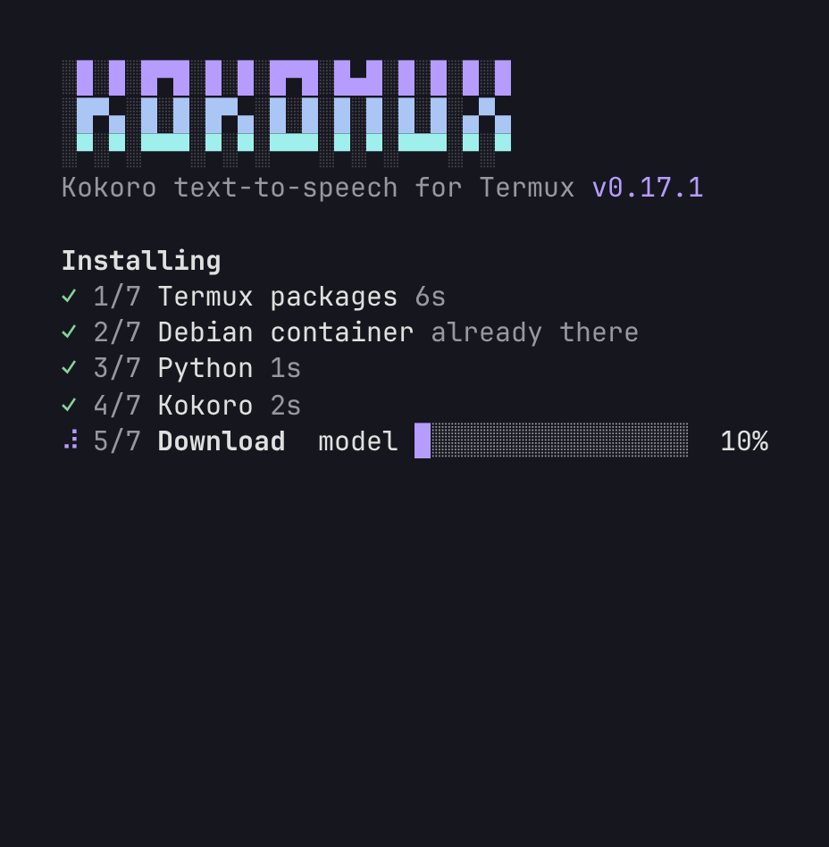
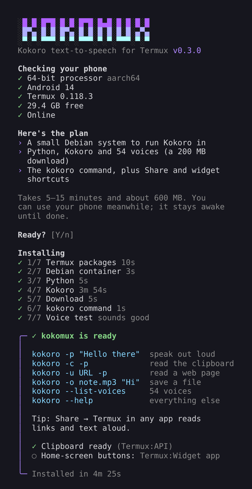
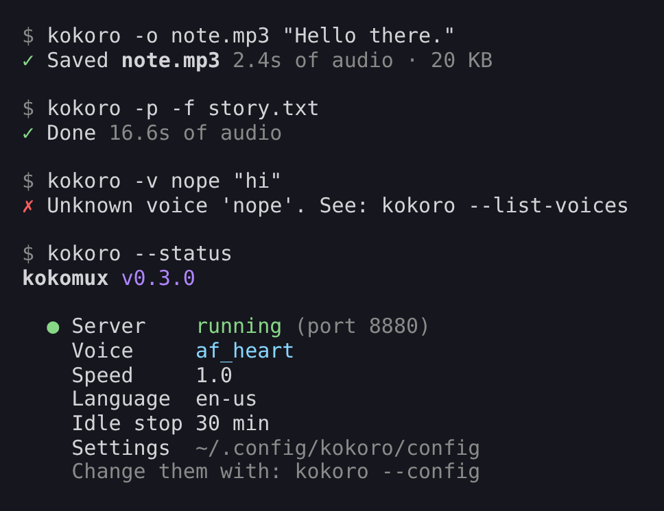
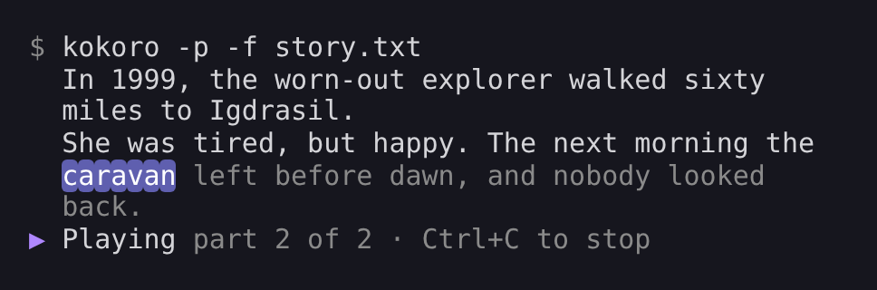
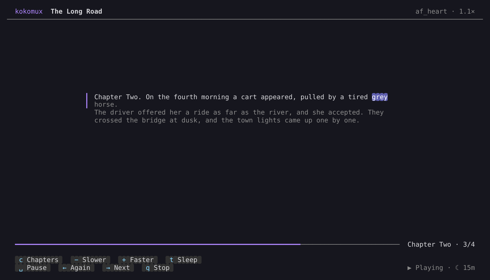
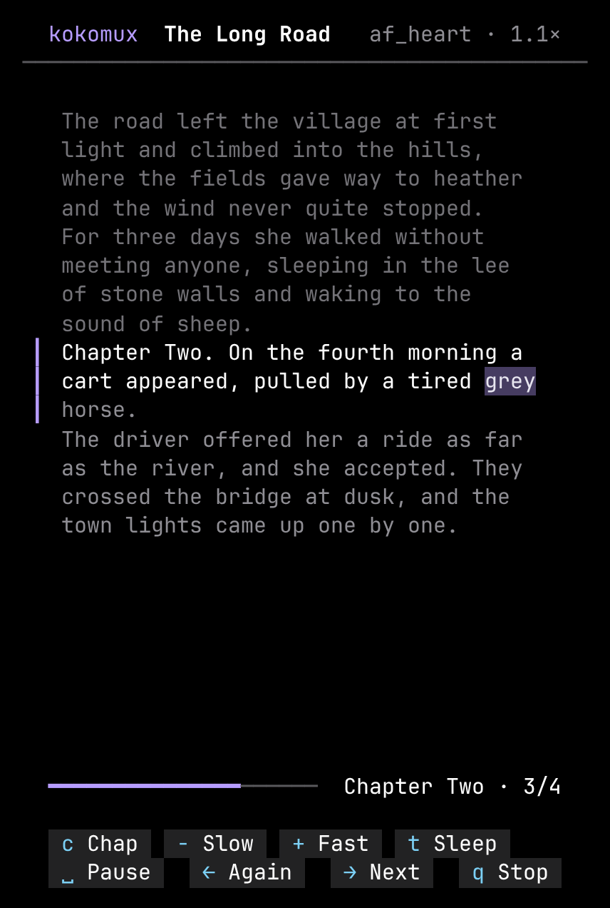
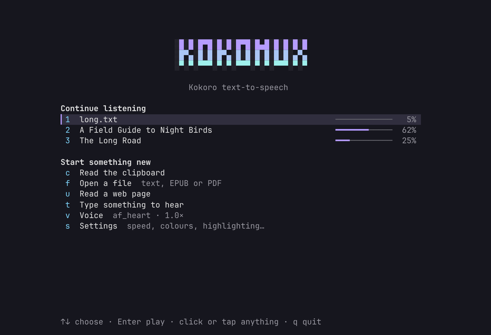
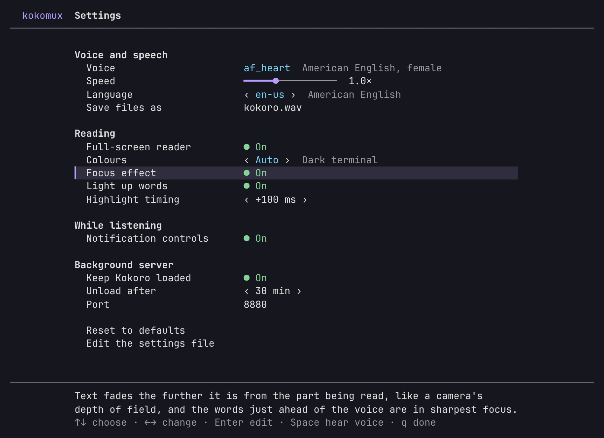
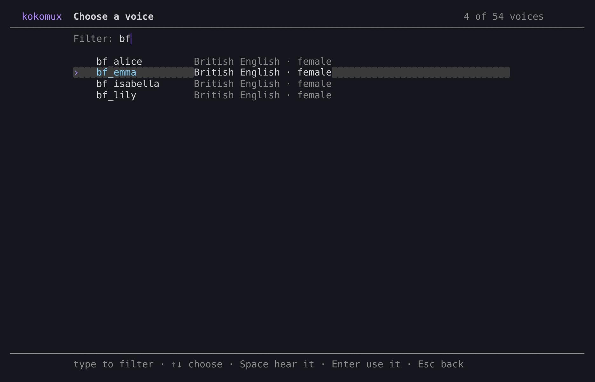

# kokomux: Kokoro TTS on Termux

Natural-sounding offline text-to-speech on your Android phone. kokomux installs [Kokoro](https://huggingface.co/hexgrad/Kokoro-82M) in Termux and gives you a `kokoro` command that can read text, files, your clipboard and web pages, either out loud or into an audio file.

```sh
kokoro -p "Hello from my phone"
```

<p>
  
  
  
</p>

While it reads aloud, kokomux shows the text and lights up each word as it's spoken:

<p></p>

## Install

You need **Termux from F-Droid or GitHub** (the Play Store version is outdated), a 64-bit phone, and about **600 MB** of free space. Then run this in Termux:

```sh
curl -fsSLO https://raw.githubusercontent.com/Anesu/kokomux/main/install.sh && bash install.sh
```

The installer checks your phone first (CPU, free space, connection), shows what it's going to do, and asks before starting. Then it works through seven steps with live progress, and keeps the phone awake until it's done. Installing takes 5–15 minutes. At the end it says hello out loud. Running it again is safe: it skips what's already done and updates the rest.

- `--yes` skips the question (for scripts).
- `--verbose` shows everything the installer runs.

If a step fails, the installer shows what went wrong and how to fix it ([example](docs/install-error.png)). The full log is kept at `~/.cache/kokomux/install.log`. If you stop it with Ctrl+C, nothing breaks: run it again and it carries on.

**Optional extras:**
- **Termux:API app** (from the same place you got Termux) plus `pkg install termux-api`, for reading the clipboard.
- **Termux:Widget app**, for home-screen buttons.

## Use

```sh
kokoro -p "Say this out loud"             # speak (starts after the first sentence)
kokoro "Save this"                        # save to kokoro.wav
kokoro -o note.mp3 "Smaller file"         # .wav .mp3 .ogg or .flac
kokoro -c -p                              # read the clipboard
kokoro -u https://example.com/article -p  # read a web page
kokoro -f story.txt -o story.mp3          # read a text file
kokoro -p -f book.epub                    # or an EPUB or PDF
cat notes.txt | kokoro -p                 # or pipe text in
kokoro --stop                             # stop playback
```

| Option | Meaning |
|---|---|
| `-p` | Play while it's being made. Nothing is saved unless you also give `-o`. |
| `-o FILE` | Save to FILE. The ending picks the format: `.wav`, `.mp3`, `.ogg` or `.flac`. |
| `-v NAME` | Voice, e.g. `af_heart`, `am_adam`, `bf_emma`, `bm_george` |
| `-s N` | Speed, 0.5–2.0 |
| `-l CODE` | Language: `en-us`, `en-gb`, `es`, `fr-fr`, `it`, `pt-br`, `hi`. Use a voice for that language too. |
| `-f FILE` | Read a text file, an EPUB or a PDF |
| `-c` | Read the clipboard. A copied link reads that web page. |
| `-u URL` | Read a web page. Menus, sidebars, tables and references are skipped. |

**Voices:** the first two letters of a voice name tell you its accent and gender. `a` is American, `b` British, then `f` for female and `m` for male. Other languages have their own voices, such as `ef_dora` for Spanish and `ff_siwis` for French. `kokoro --list-voices` shows all 54.

**Saving where other apps can find it:** run `termux-setup-storage` once, then save to shared storage, e.g. `-o ~/storage/shared/Music/note.mp3`.

## The reader and the home screen

On a terminal, `kokoro -p` opens a full-screen reader. Across the top are the title, voice and speed. In the middle is a reading column, with what you've heard above it, the part being read marked with a bar and the spoken word lit, and what's coming next dimmed below. At the bottom are a progress bar and a row of buttons. The column stays at a comfortable reading width, so it works on a phone held upright and just as well on a wide Samsung DeX or tablet screen. It follows the window when you resize it.

<p>
  
  
</p>

| Key | Click or tap | Does |
|---|---|---|
| Space | **Pause** / **Play** | pause, or carry on |
| → | **Next** | skip to the next part |
| ← | **Again** | hear this part again |
| q or Esc | **Stop** | stop, keeping your place |
| c | **Chapters** | the book's chapters: pick one to jump there (EPUBs) |
| [ and ] | | the previous or next chapter |
| − and + | **Slower** / **Faster** | change the speed while it plays, in steps of 0.1× |
| t | **Sleep** | sleep timer: 15, 30 or 60 minutes, or the end of the chapter |
| | the progress bar | click or tap it to jump to that point |

When the sleep timer runs out, the part being read finishes and playback stops, keeping your place. The reader shows the chapter you're in beside the progress bar.

With a keyboard and mouse (DeX, a tablet, or a Bluetooth keyboard), the keys and clicks both work. On a phone, tap the buttons. When you stop, kokoro says where you stopped and how to carry on.

Run `kokoro` on its own to open the **home screen**. It lists the books and long texts you're partway through, with progress bars: choose one with ↑↓ and Enter, its number, or a click. It also has one-key actions:

| Key | Does |
|---|---|
| c | read the clipboard |
| f | open a file (text, EPUB or PDF), with Tab completion |
| u | read a web page |
| t | type something to hear |
| v | choose a voice (type to filter, Space to hear it) |
| s | settings |

<p></p>

Prefer the old inline view? Set `KOKORO_TUI=0`. The keys still work there. Scripts and pipes get plain output as before.

## Listening to long texts and books

`kokoro -p -f` reads EPUBs (chapters in order, using the book's own title) and PDFs (with lines joined back into sentences, and page numbers dropped), as well as text files and web pages. DRM-protected EPUBs and scanned PDFs, which contain pictures of pages rather than text, can't be read.

**It remembers where you stopped.** Stop a long text partway, by any route: Ctrl+C, `kokoro --stop`, the notification, or even closing Termux. Then run the same command again and it picks up at the part you were on. Add `--restart` to start from the top. `kokoro --continue` carries on with the last thing you were listening to, from anywhere, in the same voice and speed. `kokoro --status` shows the bookmark. A bookmark goes away once a text has been read to the end.

**Controls while it plays:**

```sh
kokoro --pause     # pause, or carry on (picks up at the start of the part)
kokoro --next      # skip to the next part
kokoro --again     # hear this part again
kokoro --stop      # stop (the bookmark is kept)
```

A part is a sentence or two. With the Termux:API app installed, a notification shows the title and which part is playing, with **previous** (again), **pause**, **play** and **next** buttons. They work from the lock screen too. Swiping the notification away stops playback. To turn the notification off, set `KOKORO_NOTIFY=0`.

Only a few parts are made ahead of the one you're hearing, so a whole book never piles up on the phone's storage while you listen or pause. Saving a book with `-o` writes the file as it goes, so even a long book doesn't have to fit in memory.

## Words light up as they're read

With `-p` on a terminal, each line appears as it starts playing. A soft highlight then moves from word to word in time with the voice: words already spoken are shown normally and upcoming words are dim. When a line finishes it stays on screen, so a long text leaves a transcript behind. A line taller than the screen is shown as a window that follows the word being read.

How it works:

1. **Kokoro times itself.** kokomux uses an export of the Kokoro model that also reports how long it spends on every sound it makes. Those timings come with the audio, at no extra cost.
2. **Sounds become words.** Each word of the line is turned into its sounds on its own, and those are lined up against the sounds Kokoro actually spoke. So "1999" covers the three words it's spoken as, and two short words run together in speech ("in the") each still get their own moment.
3. **Highlight.** The player lights the word that matches the time since the line started playing. A line where too few sounds lined up gets no highlight rather than a wrong one, and is shown in plain text.

It works in every language Kokoro speaks, offline, and needs no extra download. To turn it off, set `KOKORO_WORDS=0`. If the highlight runs ahead of the voice on your phone, raise `KOKORO_WORDS_OFFSET_MS` (default 100); if it lags, lower it. `play-audio` doesn't report its position, so this offset covers its start-up delay.

Before 0.8, a separate speech recogniser (Whistle) listened to each line to find the words. Kokoro's own timings are more accurate, cover all nine languages instead of four, use no extra processing, and take about 70 MB less space. Updating removes Whistle.

## Use it from other apps

- **Share to Termux.** In any app, tap **Share → Termux**:
  - A **link** reads the web page aloud.
  - **Text, a text file, an EPUB or a PDF** reads that aloud.

  The installer sets this up with `~/bin/termux-url-opener` and `~/bin/termux-file-editor`. If you already had your own versions of these files, it leaves them alone and tells you.
- **Home-screen buttons.** With Termux:Widget installed, add a Termux widget to the home screen. It lists **Kokoro read clipboard**, **Kokoro pause**, **Kokoro next**, **Kokoro continue** and **Kokoro stop**. Copy some text, then tap **Kokoro read clipboard**; tap **Kokoro continue** to pick up your book.

## Settings

`kokoro --settings` (or **s** on the home screen) opens the settings menu. Move with ↑↓ or the mouse wheel. Change a value with ← and →, or with Enter, a click, or a second click. A line at the bottom says what the selected setting does. Every change is saved at once, with a ✓ Saved in the corner.

<p>
  
  
</p>

- **Voice and speech:**
  - **Voice:** a picker for all 54 voices. Type to filter (`bf` shows the British female voices), press Space to hear one say a line in its own language, and Enter to choose it. Choosing a voice also sets the matching language.
  - **Speed:** a slider from 0.5× to 2×.
  - **Language:** cycle through Kokoro's nine languages.
  - **Save files as:** the default file name.
- **Reading:**
  - **Full-screen reader:** on or off.
  - **Light up words:** on or off.
  - **Highlight timing:** in steps of 20 ms, for when the highlight runs ahead of or behind the voice.
- **While listening:** notification controls on or off.
- **Background server:** keep Kokoro loaded, how long until it unloads (5 minutes to 2 hours, or never), and the port.
- **Reset to defaults**, and **Edit the settings file** (opens it in your editor).

`kokoro --config` opens the settings file (`~/.config/kokoro/config`). There you can set your default voice, speed, language, file name, and how the background server behaves. For a single command, environment variables override the file:

```sh
KOKORO_VOICE=bm_george kokoro -p "Just this once"
```

## Speed: the background server

Starting Kokoro takes a few seconds: it has to start the Debian container and load the model. To avoid paying that every time, the first `kokoro` command starts a **background server** that keeps the model loaded. After that, each command starts almost instantly. The server stops by itself after 30 minutes without use.

```sh
kokoro --status        # is it running? what are my settings?
kokoro --serve         # start it now
kokoro --stop-server   # stop it and free its memory
```

If you'd rather not have it, set `KOKORO_AUTOSERVE=0` in the settings. Each command then loads Kokoro on its own, which is slower but uses no memory in between.

The server only listens on the phone itself (127.0.0.1). It needs a secret token that only Termux can read, so other apps can't use it.

## Update and uninstall

```sh
kokoro --update      # get the latest kokomux and Kokoro
kokoro --uninstall   # remove the container, the command, settings and helper scripts
```

## How it works

Kokoro's Python packages (`onnxruntime`, `espeakng-loader`, `soundfile`) only ship builds for standard Linux (glibc). Termux uses Android's own C library, so they can't run there directly. The installer therefore creates a small Debian container called `kokoro` with `proot-distro`, and runs Kokoro inside it. The parts:

- **`kokoro`** (Termux side): reads your text, starts or uses the server, and hands each run to the player.
- **`player.sh` and `tui.sh`** (Termux side): play the audio with `play-audio`, and draw the reader, home screen and settings.
- **`engine.py`** (inside Debian): splits the text into sentences and runs Kokoro. With `-p` it hands back audio one chunk at a time, so playback starts after the first sentence.
- **`words.py`** (inside Debian): turns Kokoro's per-sound timings into word timings, for the highlight.
- **Sharing files:** the two sides exchange text and audio through `$PREFIX/tmp`, which the container sees as `/tmp`.

The installer only keeps what's needed in the container. It skips documentation and man pages, and clears the apt and pip download caches after installing. The model is the 8-bit timestamped export from onnx-community (92 MB, pinned to one version), plus about 28 MB of voices.

**Why not run natively in Termux?** Termux now packages onnxruntime, numpy, espeak and libsndfile, but kokoro-onnx's own dependencies still can't be installed there. `espeakng-loader` ships only glibc builds. `phonemizer` needs `segments`, which needs the `regex` C extension, and `soundfile` needs `cffi`; Termux packages neither, so both would have to be compiled on the phone. Until that's simpler, and can be tested on a real device, the container stays.

## Troubleshooting

- **`pkg` errors or mirror problems:** run `termux-change-repo`, pick another mirror, then `pkg upgrade`.
- **A download failed:** run the installer again. Model downloads pick up where they stopped.
- **`-c` hangs or fails:** you need both the Termux:API **app** and `pkg install termux-api`.
- **No sound:** check the media volume. Also make sure `play-audio` is installed (`pkg install play-audio`).
- **"Process completed (signal 9)", or the server keeps disappearing:** Android 12+ kills background processes it considers excessive. Search for "Termux phantom process killer" for the one-time fix.
- **Server problems:** `kokoro --stop-server` and try again. Its log is in `$PREFIX/tmp/kokoro-server/log`.

## Development

The files in `src/` are the source. `./build.sh` bundles them into the single `install.sh` that people download, so after editing anything in `src/`, run `./build.sh` and commit both.

| File | What it is |
|---|---|
| `src/kokoro` | the `kokoro` command (Termux side) |
| `src/player.sh` | playing a text: highlights, controls, bookmarks, chapters, sleep timer (Termux side) |
| `src/tui.sh` | the full-screen reader, home screen and settings (Termux side) |
| `src/engine.py` | Kokoro engine, server, web-page reader and model downloader (container side) |
| `src/words.py` | word timings from Kokoro's per-sound timings (container side) |
| `tests/test_words.py` | tests for word timings, on recorded Kokoro output: `python3 tests/test_words.py` |
| `tests/test_books.py` | tests for reading EPUB, PDF and text: `python3 tests/test_books.py` |
| `src/setup-container.sh` | installs everything inside the container |
| `src/install.sh` | installer template (UI, checks, steps) |
| `VERSION` | the version stamped into both by `build.sh` |
