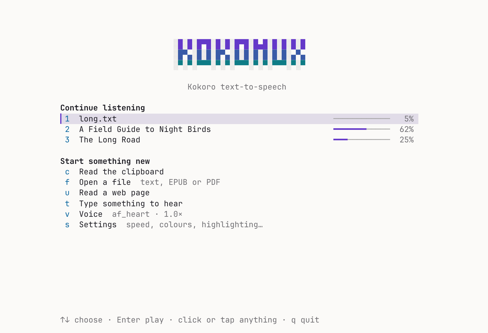
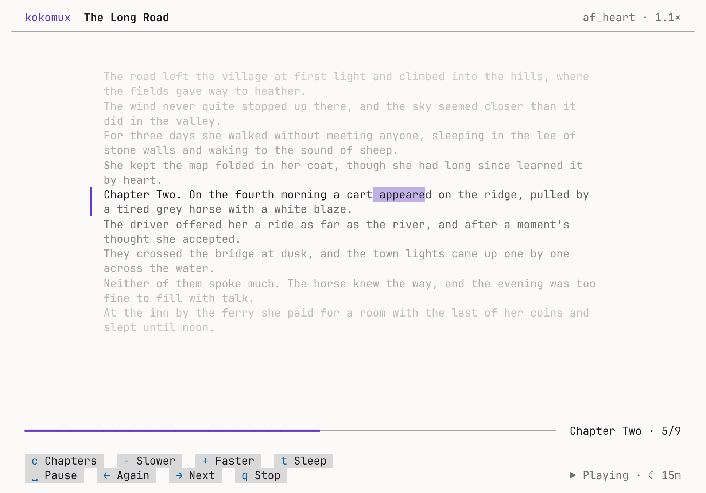

# kokomux: Kokoro TTS on Termux

Natural-sounding offline text-to-speech on your Android phone. kokomux installs [Kokoro](https://huggingface.co/hexgrad/Kokoro-82M) in Termux and gives you a `kokoro` command that can read text, files, your clipboard and web pages, either out loud or into an audio file.

```sh
kokoro -p "Hello from my phone"
```

<p>
  
  
  
</p>

While it reads aloud, kokomux shows the text and lights up each word as it's spoken:

<p></p>

## Install

You need **Termux from F-Droid or GitHub** (the Play Store version is outdated) and about **1.2 GB** of free space. Then run this in Termux:

```sh
curl -fsSLO https://raw.githubusercontent.com/Anesu/kokomux/main/install.sh && bash install.sh
```

It works through seven steps with live progress and keeps the phone awake until it's done, about 10–20 minutes. At the end it says hello out loud. Running it again skips what's already done and updates the rest; `--verbose` shows everything it runs.

If a step fails, the installer shows the error and what to do ([example](docs/install-error.png)); the full log is at `~/.cache/kokomux/install.log`. After Ctrl+C, run it again and it carries on.

**Optional extras:**
- **Termux:API app** (from the same place you got Termux) plus `pkg install termux-api`, for reading the clipboard.
- **Termux:Widget app**, for home-screen buttons.

## Use

```sh
kokoro -p "Say this out loud"             # speak (starts after the first sentence)
kokoro "Save this"                        # save to kokoro.wav
kokoro -o note.mp3 "Smaller file"         # .wav .mp3 .ogg or .flac
kokoro -f book.epub -o book.m4b           # an audiobook, with chapters
kokoro -c -p                              # read the clipboard
kokoro -u https://example.com/article -p  # read a web page
kokoro -f story.txt -o story.mp3          # read a text file
kokoro -p -f book.epub                    # or an EPUB or PDF
cat notes.txt | kokoro -p                 # or pipe text in
kokoro --stop                             # stop playback
```

| Option | Meaning |
|---|---|
| `-p` | Play while it's being made. Nothing is saved unless you also give `-o`. |
| `-o FILE` | Save to FILE. The ending picks the format: `.wav`, `.mp3`, `.ogg`, `.flac`, or `.m4b` for an audiobook with chapters. |
| `-v NAME` | Voice, e.g. `af_heart`, `am_adam`, `bf_emma`, `bm_george`, or a blend: `af_heart:70+bf_emma:30` |
| `-s N` | Speed, 0.5–2.0 |
| `-l CODE` | Language: `en-us`, `en-gb`, `es`, `fr-fr`, `it`, `pt-br`, `hi`. Use a voice for that language too. |
| `-f FILE` | Read a text file, an EPUB or a PDF |
| `-c` | Read the clipboard. A copied link reads that web page. |
| `-u URL` | Read a web page: just the article (found by trafilatura), up to where the links start. |

**Voices:** the first two letters of a voice name tell you its accent and gender. `a` is American, `b` British, then `f` for female and `m` for male. Other languages have their own voices, such as `ef_dora` for Spanish and `ff_siwis` for French. `kokoro --list-voices` shows all 54.

## How it sounds this good

- **Full precision.** kokomux runs Kokoro's full-precision model (326 MB), not the 8-bit version, which can sound faintly buzzy.
- **English pronunciation.** English (American and British) is turned into sounds by misaki, the dictionary-based tool Kokoro was trained with, rather than espeak, which gets some words wrong. misaki picks the right reading from the sentence:

  | | espeak | misaki |
  |---|---|---|
  | "I **read** the book yesterday" | "reed" | "red" |
  | "please **record** the record" | "REC-ord" both times | "re-CORD", then "REC-ord" |
  | "**wind** the clock" | "wind", as in breeze | "wynd" |
  | "$42.50" | "dollar forty-two point five zero" | "forty-two dollars and fifty cents" |

  It uses spaCy's small English model to tell a noun from a verb. Words misaki doesn't know, and other languages, go to espeak.
- **Blend voices.** Mix two (or up to four) voices into one of your own: `-v af_heart:70+bf_emma:30` is 70% `af_heart` and 30% `bf_emma`, and `af_heart+af_bella` is half and half. In the settings, **Blend with** picks the second voice and **Blend amount** sets how much of it you hear (10% to 90%). Press Space on either to hear the mix. `af_heart` and `af_bella` are Kokoro's strongest voices, so they make a good base.
- **Smooth joins.** A long text is read in parts of a few whole sentences each (up to 360 characters), never across a paragraph. Each part ends with a pause that fits where it is: 0.25 s after a sentence, as Kokoro pauses inside a part, then longer after a paragraph (0.65 s) and a chapter (1.06 s). Those are golden-ratio steps. The edges of each part are softened by a few milliseconds, so they can't click. Saved files get the same pauses.
- **Text made speakable.** Before reading, kokomux tidies what's meant for the eye:
  - ligatures from PDFs (fi), footnote marks (¹, [3]) and markdown
  - links, read as just their site (`example.com`)
  - dashes, read as a pause, and number ranges ("1990–1995" is read as "1990 to 1995")
  - Roman numerals in headings ("Chapter IV" is read as "Chapter 4") and ALL-CAPS headings
  - in English, titles (Dr., Mrs., St.), abbreviations (e.g., i.e., etc., vs., No., p.), times (5 p.m.) and units (km, mph, °C, kg)

  The reader shows the tidied text, so the word that's lit is the word you hear. An abbreviation or initial ("J. R. R. Tolkien") never ends a part.

**Saving where other apps can find it:** run `termux-setup-storage` once, then save to shared storage, e.g. `-o ~/storage/shared/Music/note.mp3`.

## The reader and the home screen

On a terminal, `kokoro -p` opens a full-screen reader. Across the top are the title, voice and speed. In the middle is a reading column, with what you've heard above it, the part being read marked with a bar and the spoken word lit, and what's coming next dimmed below. The part being read sits on the golden line, 38% of the way down, where the eye naturally rests.

**The focus effect.** Like a camera's depth of field, the text fades the further it is from the part being read, down to a faint ghost at the edges of the screen, so your eye stays on the line being spoken. Ahead of the voice, the next few words are in sharpest focus and the rest of the sentence settles behind them. When a part ends, it eases out of focus over about a third of a second as the next one comes in. The fade follows the golden ratio: a quarter of a golden step for every half-line or so, never fainter than 14.6% of the way from the background to the text. A terminal can't blur text, so the effect works with brightness alone. If you'd rather see everything evenly, turn off **Focus effect** in the settings (or set `KOKORO_FOCUS=0`). At the bottom: what's happening, a progress bar, the play controls, and a quieter row with the speed, sleep timer, chapters and menu. The column stays at a comfortable reading width, so it works on a phone held upright and just as well on a wide Samsung DeX or tablet screen. It follows the window when you resize it.

<p>
  
  
</p>

| Key | Click or tap | Does |
|---|---|---|
| Space | **‖ Pause** / **▶ Play** | pause mid-word, or carry on from there (a few seconds back after a long pause) |
| → | **Next ›** | skip to the next part |
| ← | **‹ Again** | hear this part again |
| − and + | **−** / **+** either side of the speed | change the speed at once, in steps of 0.1× |
| t | **☾ Sleep** | sleep timer: 15, 30 or 60 minutes, or the end of the chapter |
| c | **Chapters** | the book's chapters: pick one to jump there (EPUBs) |
| [ and ] | | the previous or next chapter |
| m | **≡ Menu** | settings, voice, chapters, sleep timer, the home screen, stop |
| s | | settings, without leaving the book |
| v | | choose a voice |
| q or Esc | Menu → **Stop** | stop, keeping your place |
| | the progress bar | click or tap it to jump to that point |

Above the bar, a line says what's happening (playing, paused, how much of the book is made) and where you are (chapter, part). Playback carries on while the menu or settings are open; a new voice or language starts again at the part you're on.

**A new speed is heard at once.** The part you're on carries on at the new speed, with its pitch kept, while the rest is made again at that speed behind it. From the next part on you hear Kokoro speaking at the new speed itself, which sounds more natural than a sped-up recording.

**Back a little after a long pause.** Carry on after a minute or more away and it goes back 5 seconds first, or 10 after an hour, so you pick up the thread.

The sleep timer fades the voice out over its last 13 seconds, then stops, keeping your place at the start of the sentence it faded on. With **end of chapter**, it fades over the end of the chapter's last part. Time spent paused doesn't count towards it. The reader shows the chapter you're in beside the progress bar.

With a keyboard and mouse (DeX, a tablet, or a Bluetooth keyboard), the keys and clicks both work. On a phone, tap the buttons. When you stop, kokoro says where you stopped and how to carry on.

Run `kokoro` on its own to open the **home screen**. Its **bookshelf** lists the books, web novels and long texts you're partway through, with progress bars: choose one with ↑↓ and Enter, its number, or a click. It also has one-key actions:

| Key | Does |
|---|---|
| c | read the clipboard |
| f | open a file (text, EPUB or PDF), with Tab completion |
| u | read a web page |
| t | type something to hear |
| v | choose a voice (type to filter, Space to hear it) |
| s | settings |

<p>
  
  
</p>

Prefer the old inline view? Set `KOKORO_TUI=0`. The keys still work there. Scripts and pipes get plain output as before.

## Colours: dark and light

kokomux fits your terminal's own colours, whether it's dark or light. When a screen opens, it asks the terminal for its background colour (most terminals, Termux included, answer at once) and builds the palette from it. Your colour scheme, whether that's Termux's black, Solarized, Dracula or a paper-white light theme, gets matching greys rather than a fixed set that suits only some of them. It remembers the answer, so the plain `kokoro` messages match too.

<p>
  
  
</p>

The palette follows a few design rules:

- **Greys in golden-ratio steps.** Every grey is your background moved part of the way towards the text colour: 61.8% for secondary text, 38.2% for rules and the progress track, 23.6% for texture, and 14.6% for buttons and the selected row. Each step is φ (1.618) times the next, so the levels look evenly spaced, and there are only a handful of them.
- **Readable on every background.** Text has at least 7:1 contrast, and accents and secondary text about 4.5:1 (the WCAG guidelines), on 15 popular dark and light terminal themes. `tests/test_theme.py` checks this.
- **Two accent sets.** Lighter violet and sky blue on dark backgrounds, deeper ones on light. The spoken word sits on a soft accent wash, with what you've heard fading slightly behind it.
- **Golden proportions in the layout.** The line being read sits 38.2% of the way down. The home screen's free space is split 1 : φ above and below, the optical centre. Settings split their width into labels and values the same way.

**Colours** in the settings (or `KOKORO_THEME` in the settings file) chooses:

| Setting | Does |
|---|---|
| Auto | follow the terminal (the default) |
| Dark or Light | always use that palette in the full-screen views, painting its own background if the terminal is the other kind |

Without 24-bit colour, the nearest of the terminal's 256 colours is used. `NO_COLOR` turns colours off.

## Listening to long texts and books

`kokoro -p -f` reads EPUBs (chapters in order, using the book's own title) and PDFs (with lines joined back into sentences, and page numbers dropped), as well as text files and web pages. DRM-protected EPUBs and scanned PDFs, which contain pictures of pages rather than text, can't be read.

**It remembers where you stopped.** Stop a long text partway, by any route: Ctrl+C, `kokoro --stop`, the notification, or even closing Termux. Then run the same command again and it picks up at the part you were on. Add `--restart` to start from the top. `kokoro --continue` carries on with the last thing you were listening to, from anywhere, in the same voice and speed. `kokoro --status` shows the bookmark. A bookmark goes away once a text has been read to the end.

**Controls while it plays:**

```sh
kokoro --pause     # pause, or carry on from that exact word
kokoro --next      # skip to the next part
kokoro --again     # hear this part again
kokoro --stop      # stop (the bookmark is kept)
```

A part is a few sentences. With the Termux:API app installed, a notification shows the title and which part is playing, with **previous** (again), **pause**, **play** and **next** buttons. They work from the lock screen too. Swiping the notification away stops playback. To turn the notification off, set `KOKORO_NOTIFY=0`.

**Gapless, and made ahead.** One mpv plays the whole listen as a playlist, so each part runs straight into the next, and pause stops mid-word and carries on from there. Behind it, Kokoro stays about ten minutes ahead of you and then makes one part as each is heard, so a long book doesn't keep the phone busy and warm for hours. Skipping and seeking within what's made are instant; a jump further on starts making from there. Everything made is kept per book, voice and speed in `$PREFIX/tmp/kokomux-cache`, so listening again, or making the audiobook, reuses it. A book's audio is deleted once you've heard it to the end; the cache never grows past `KOKORO_CACHE_GB` (50 GB), letting go of the books heard least recently.

## Audiobooks

`kokoro -f book.epub -o book.m4b` makes an audiobook: AAC in an `.m4b`, with a chapter mark for each of the book's chapters, its title and author, and its cover. Any app that plays audiobooks shows the chapters, so it works in the car, on a watch or in your favourite player. It reuses whatever you've already listened to in the same voice and speed, keeps the phone awake while it works, and shows how far it's got. Text files and web pages work too, as one chapter.

## Web novels

Give kokomux a chapter of a web novel, from freewebnovel.com or any site laid out like it, and it reads the novel, not just the page:

```sh
kokoro -p -u https://freewebnovel.com/novel/starting-with-an-sss-rank-goddess-summon/chapter-5
```

(or open the chapter in your browser and share it to Termux, or press **u** on the home screen.)

- **The chapter, and only the chapter.** It finds the novel's title, the chapter's number and title, and the chapter's text, leaving out the site's menus, ads, comments and "read it at…" lines. Each chapter starts with its name, so you hear "Chapter 5: Weapon Haggling."
- **On to the next chapter, without a gap.** It follows the page's "Next chapter" link, or works out `chapter-6` from `chapter-5`. The next chapter is fetched and made while you listen to this one, one chapter ahead.
- **On the bookshelf.** The home screen shows the novel with the chapter you're on (*The Long Road · Ch 12*). Enter carries on where you stopped, in that chapter; **g** goes to any chapter by its number. `kokoro --continue` works too.
- **In the reader**, **[** and **]** move between chapters (back past where you started, too) and **c** goes to a chapter by its number.
- **Caught up?** When you reach the newest chapter out, it says so and keeps the novel on the shelf. Carry on later and it starts with the next chapter, once there is one.

kokomux fetches pages the way your phone's browser does. A site that asks for a browser check first (Cloudflare's "Just a moment…") can't be read this way.

## The queue

Share a link or a file to Termux and it joins your **queue** instead of playing at once, like a podcast playlist. Play it when you're ready:

```sh
kokoro --queue          # play the queue in order (also p on the home screen, or the Kokoro play queue widget)
kokoro --queue list     # what's waiting
kokoro --queue skip     # drop the first one
kokoro --queue clear    # empty it
kokoro --add -u URL     # add a page yourself (or -f FILE, -c for the clipboard, or some text)
```

Each item plays to the end and leaves the queue, and the next one starts. Stopping (q, the notification, or the sleep timer) stops the queue and keeps your place: the item stays first, with its bookmark. The home screen shows what's up next.

## Words light up as they're read

With `-p` on a terminal, each line appears as it starts playing. A soft highlight then moves from word to word in time with the voice: words already spoken are shown normally and upcoming words are dim. When a line finishes it stays on screen, so a long text leaves a transcript behind. A line taller than the screen is shown as a window that follows the word being read.

How it works:

1. **Kokoro times itself.** kokomux uses an export of the Kokoro model that also reports how long it spends on every sound it makes. Those timings come with the audio, at no extra cost.
2. **Sounds become words.** Each word of the line is turned into its sounds on its own, and those are lined up against the sounds Kokoro actually spoke. So "1999" covers the three words it's spoken as, and two short words run together in speech ("in the") each still get their own moment.
3. **Highlight.** The player lights the word that matches mpv's playback position in the line. A line where too few sounds lined up gets no highlight rather than a wrong one, and is shown in plain text.

It works in every language Kokoro speaks, offline, and needs no extra download. To turn it off, set `KOKORO_WORDS=0`. The highlight follows mpv's own playback clock; to shift it, use **Highlight timing** in the settings (`KOKORO_WORDS_OFFSET_MS`, + later, − earlier).

## Use it from other apps

- **Share to Termux.** In any app, tap **Share → Termux**. A **link**, **text, a text file, an EPUB or a PDF** joins your [queue](#the-queue).

  The installer sets this up with `~/bin/termux-url-opener` and `~/bin/termux-file-editor`. If you already had your own versions of these files, it leaves them alone and tells you.
- **Home-screen buttons.** With Termux:Widget installed, add a Termux widget to the home screen. It lists **Kokoro read clipboard**, **Kokoro play queue**, **Kokoro pause**, **Kokoro next**, **Kokoro continue** and **Kokoro stop**. Copy some text, then tap **Kokoro read clipboard**; tap **Kokoro continue** to pick up your book.

## Settings

`kokoro --settings` (or **s** on the home screen) opens the settings menu. Move with ↑↓ or the mouse wheel. Change a value with ← and →, or with Enter, a click, or a second click. A line at the bottom says what the selected setting does. Every change is saved at once, with a ✓ Saved in the corner.

<p>
  
  
</p>

- **Voice and speech:**
  - **Voice:** a picker for all 54 voices. Type to filter (`bf` shows the British female voices), press Space to hear one say a line in its own language, and Enter to choose it. Choosing a voice also sets the matching language.
  - **Blend with** and **Blend amount:** a second voice mixed into yours, from 10% to 90%. Space hears the mix; ← on **Blend with** turns it off.
  - **Speed:** a slider from 0.5× to 2×.
  - **Language:** cycle through Kokoro's nine languages.
  - **Save files as:** the default file name.
- **Reading:**
  - **Full-screen reader:** on or off.
  - **Colours:** Auto, Dark or Light (see [Colours](#colours-dark-and-light)).
  - **Focus effect:** text fades with its distance from the line being read; on or off.
  - **Light up words:** on or off.
  - **Highlight timing:** in steps of 20 ms, for when the highlight runs ahead of or behind the voice.
- **While listening:** notification controls on or off.
- **Background server:** keep Kokoro loaded, how long until it unloads (5 minutes to 2 hours, or never), and the port.
- **Reset to defaults**, and **Edit the settings file** (opens it in your editor).

`kokoro --config` opens the settings file (`~/.config/kokoro/config`). There you can set your default voice, speed, language, file name, and how the background server behaves. For a single command, environment variables override the file:

```sh
KOKORO_VOICE=bm_george kokoro -p "Just this once"
```

## Speed: the background server

Starting Kokoro takes a few seconds: it has to start the Debian container and load the model. To avoid paying that every time, the first `kokoro` command starts a **background server** that keeps the model loaded. After that, each command starts almost instantly. It stays loaded until you stop it (`kokoro --stop-server`); to have it unload after a while without use, set **Unload after** in `kokoro --settings`.

```sh
kokoro --status        # is it running? what are my settings?
kokoro --serve         # start it now
kokoro --stop-server   # stop it and free its memory
```

If you'd rather not have it, set `KOKORO_AUTOSERVE=0` in the settings. Each command then loads Kokoro on its own, which is slower but uses no memory in between.

`kokoro --benchmark` times Kokoro on your phone a few ways (thread counts, and how work is spread across cores of different speeds), shows how many times faster than real time each is, and keeps the fastest for the server.

The server only listens on the phone itself (127.0.0.1). It needs a secret token that only Termux can read, so other apps can't use it.

## Update and uninstall

```sh
kokoro --update          # get the latest kokomux and Kokoro (from main)
kokoro --update BRANCH   # or from a branch, before it's merged
kokoro --uninstall   # remove the container, the command, settings and helper scripts
```

## How it works

Kokoro's Python packages (`onnxruntime`, `espeakng-loader`, `soundfile`) only ship builds for standard Linux (glibc). Termux uses Android's own C library, so they can't run there directly. The installer therefore creates a small Debian container called `kokoro` with `proot-distro`, and runs Kokoro inside it. The parts:

- **`kokoro`** (Termux side): reads your text, starts or uses the server, and hands each run to the player.
- **`player.sh`, `tui.sh` and `theme.sh`** (Termux side): play the audio through one mpv (gapless, controlled over its IPC socket with socat), and draw the reader, home screen and settings in colours made from the terminal's own. ffmpeg makes the audiobooks.
- **`engine.py`** (inside Debian): splits the text into sentences and runs Kokoro. With `-p` it hands back audio one chunk at a time, so playback starts after the first sentence.
- **misaki** (inside Debian): turns English into sounds the way Kokoro was trained, using spaCy to tell a noun from a verb.
- **`words.py`** (inside Debian): turns Kokoro's per-sound timings into word timings, for the highlight.
- **Sharing files:** the two sides exchange text and audio through `$PREFIX/tmp`, which the container sees as `/tmp`.

The installer only keeps what's needed in the container. It skips documentation and man pages, and clears the apt and pip download caches after installing. The model is the full-precision timestamped export from onnx-community (326 MB, pinned to one version), plus about 28 MB of voices. Each is kept only if its SHA-256 is the one written in `engine.py`.

**Why not run natively in Termux?** Termux now packages onnxruntime, numpy, espeak and libsndfile, but kokoro-onnx's own dependencies still can't be installed there. `espeakng-loader` ships only glibc builds. `phonemizer` needs `segments`, which needs the `regex` C extension, and `soundfile` needs `cffi`; Termux packages neither, so both would have to be compiled on the phone. Until that's simpler, and can be tested on a real device, the container stays.

## Troubleshooting

- **`pkg` errors or mirror problems:** run `termux-change-repo`, pick another mirror, then `pkg upgrade`.
- **A download failed:** run the installer again. Model downloads pick up where they stopped.
- **`-c` hangs or fails:** you need both the Termux:API **app** and `pkg install termux-api`.
- **No sound:** check the media volume. `mpv some.mp3` in Termux should play; if not, `pkg install mpv socat`.
- **The keyboard won't come up:** in kokoro's screens a tap is a click on the screen, so it doesn't open the keyboard. Swipe in from the left edge and tap **KEYBOARD**.
- **"Process completed (signal 9)", or the server keeps disappearing:** Android 12+ kills background processes it considers excessive. Search for "Termux phantom process killer" for the one-time fix.
- **Server problems:** `kokoro --stop-server` and try again. Its log is in `$PREFIX/tmp/kokoro-server/log`.

## Development

The files in `src/` are the source. `./build.sh` bundles them into the single `install.sh` that people download, so after editing anything in `src/`, run `./build.sh` and commit both. [AGENTS.md](AGENTS.md) explains how the pieces fit, the conventions and the traps.

```
dev/check.sh                 # build, then shellcheck, pyflakes and every test
dev/map.sh                   # every function in src/, and what it's for
dev/rig.sh                   # once: a stand-in phone in .dev/ with the real Kokoro model
dev/kokoro -p -f story.txt   # run kokoro from src/ on it
python3 dev/screen.py --out reader.png -- dev/kokoro -p -f story.txt   # a picture of the screen
```

| File | What it is |
|---|---|
| `src/kokoro` | the `kokoro` command (Termux side) |
| `src/player.sh` | playing a text: mpv, highlights, controls, bookmarks, chapters, sleep timer (Termux side) |
| `src/tui.sh` | the full-screen reader, menu, home screen and settings (Termux side) |
| `src/theme.sh` | the colours: dark and light palettes built from the terminal's background (Termux side and installer) |
| `src/engine.py` | Kokoro engine, server, web-page reader and model downloader (container side) |
| `src/words.py` | word timings from Kokoro's per-sound timings (container side) |
| `src/setup-container.sh` | installs everything inside the container |
| `src/install.sh` | installer template (UI and steps) |
| `VERSION` | the version stamped into both by `build.sh` |
| `tests/test_words.py` | word timings, on recorded Kokoro output |
| `tests/test_books.py` | reading EPUB, PDF and text |
| `tests/test_text.py` | tidying text and splitting it into parts |
| `tests/test_job.py` | running a job with a stand-in for Kokoro: pauses, kept parts, blends, misaki, chapter times, bookmarks |
| `tests/test_web.py` | reading web pages (needs trafilatura) |
| `tests/test_reader.py` | the reader's focus effect |
| `tests/test_player.py` | a new speed heard at once, and the sleep timer's fade |
| `tests/test_novel.py` | web novels: reading a chapter page, and listening on from chapter to chapter (a made-up novel served locally) |
| `tests/test_settings.py` | every setting in the menu changes and is saved |
| `tests/test_screens.py` | the real screens driven with keys and taps in a pseudo-terminal: home, settings, voices, and (with `dev/rig.sh`) the reader |
| `tests/test_commands.py` | the command-line options: the queue, status, stop, and error messages |
| `tests/test_theme.py` | the colours: contrast on 15 terminal themes, the golden steps, asking the terminal |
| `dev/check.sh` | everything to run before a commit |
| `dev/map.sh` | a map of the code: each file's sections and functions, with what each is for |
| `dev/rig.sh`, `dev/kokoro` | a stand-in phone (fake `$PREFIX`, container venv, models) to run kokoro for real |
| `dev/screen.py`, `dev/shot.js` | runs a command in a terminal and saves its screen as HTML and PNG |

Each test file runs on its own (`python3 tests/test_text.py`) or with pytest.

**The Android app** is in `android/`: Kokoro and misaki in an app of their own, with engine.py's text side packaged in as it is, and two more engines (Ming 3.0 on the phone's NPU, and Qwen3-TTS for voices cloned from a clip), web novels heard chapter after chapter, listening stats, saved passages, audiobooks and a widget. See [android/README.md](android/README.md); GitHub Actions builds its debug APK.
